# PhotoEditKit for Android

[](#installation)
[](#requirements)
[](#requirements)
[](#privacy)

**One call gives a photo the edit it needs, entirely on the device.**

PhotoEditKit is a photo editing toolkit for Android apps. It analyzes each photo
(exposure, colour cast, faces, hands, subject placement, sensor grain, and scene
type) and suggests tailored edits you can present in a picker or apply
instantly. It also includes the renderer that applies them, framing (straighten,
crop, turn, flip), Ultra HDR and Motion Photo saving, and scene-aware video
looks on Media3.

| Original | AI edit |
| :---: | :---: |
| 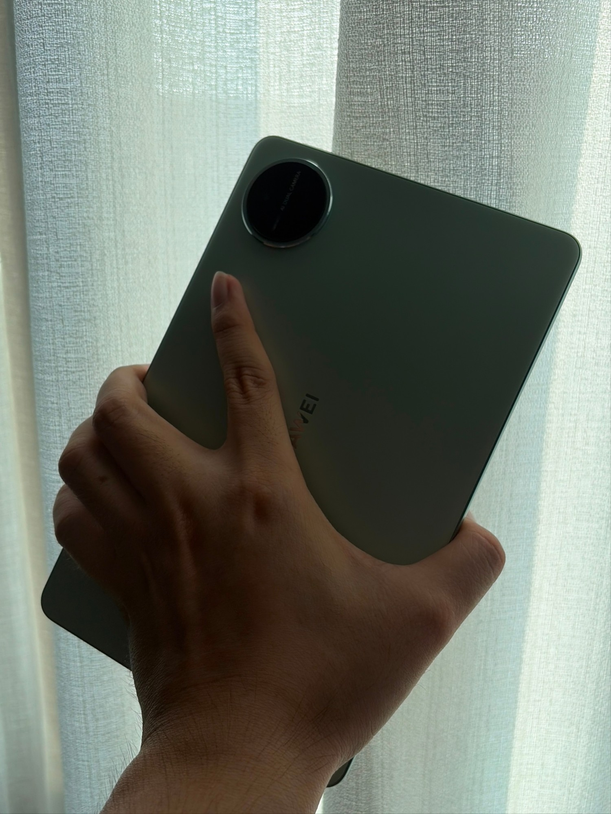 | 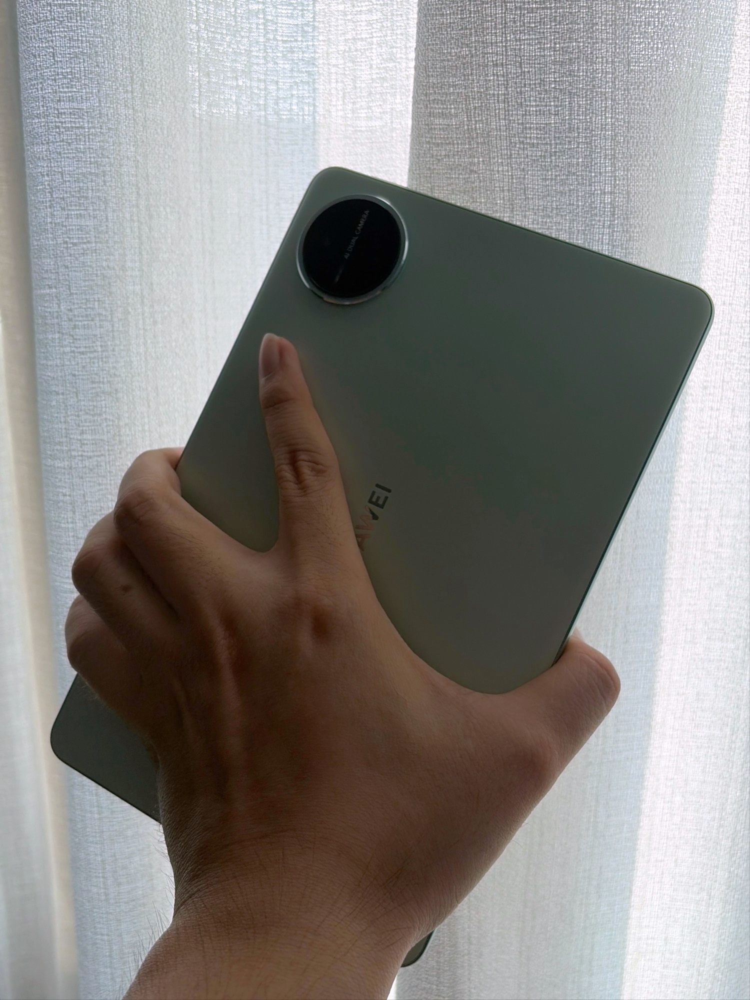 |
| 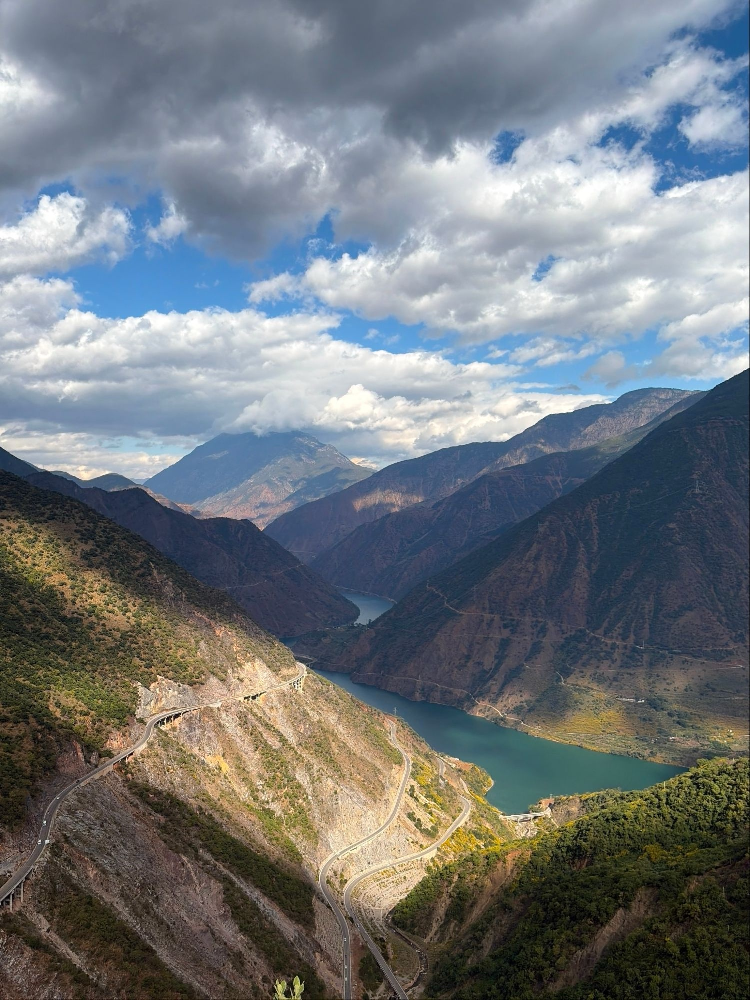 | 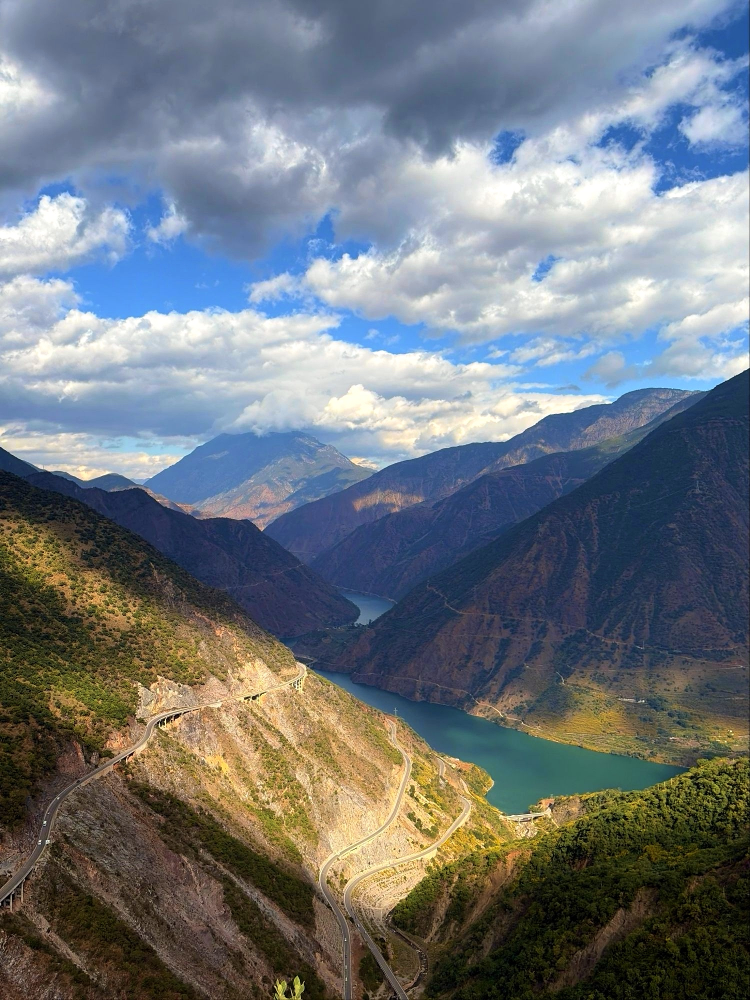 |

[More examples](#examples)

```kotlin
val result = PhotoEditKit.suggestions(context, bitmap, exif)
result.suggestions.firstOrNull()?.let { best ->
    val edited = PhotoEditKit.renderedEdit(bitmap, best.config)
}
```

## Features

- **Adaptive AI suggestions.** Delivers up to ten ranked looks per photo
  (configurable limit) with localized titles and rendered thumbnails. Optionally
  leads with **Original** when no look improves the photo.
- **Targeted corrections and styles.** Corrective recipes (Brighten, Lift
  Shadows, Recover Highlights, Warm Up, Cool Down, True Color, Clean Up) resolve
  exposure, cast, and noise flaws. Stylistic recipes (Vivid, Punch, Muted,
  Soft) apply looks calibrated to each photo, and opt-in themes (Manga, B&W,
  Film, Matte) restyle it.
  [See all recipes](#the-recipes).
- **Skin tone preservation.** Safeguards facial skin hue and saturation across
  all recipes, keeping skin tones natural even under strong colour moves.
- **On-device preference learning.** Adapts suggestions to user choices and
  subsequent slider tweaks, clustered by photo characteristics and scene type.
  [How it works](#learning-from-saves).
- **A full edit model.** Every suggestion is a plain `EditConfig` of slider
  values (exposure, tone, white balance, an 8-band colour mixer, sharpening,
  noise reduction, vignette) that your UI can show and change. No hidden
  adjustments.
- **Framing.** Straighten, crop to a ratio, quarter turns and flips, with the
  vignette drawn on the final frame.
- **A ready-made preview.** `EditPreviewView` shows a photo with its edit:
  it opens large photos at screen size, renders in the background, and on
  Android 13 and later draws slider moves on the GPU in a few milliseconds.
  [Showing an edit](#showing-an-edit-editpreviewview).
- **Ultra HDR.** Saves keep the photo's HDR gain map (Android 14 and later).
- **Motion Photos.** Reads Google Motion Photos and writes them back with the
  same edit on the video.
- **Multi-scene video looks.** The AI evaluates the opening frame and works the
  chosen look out again for each later scene to match changes in light. Users
  can adjust any keyframe. Preview with ExoPlayer and export with Transformer,
  both with the edit on the GPU. [Editing videos](#editing-videos).
- **Private by design.** Zero network requests, no remote models to download,
  and no user tracking.
- **Localized** in English, Simplified Chinese, Traditional Chinese, Japanese,
  and Korean.

## Contents

- [How it fits into your app](#how-it-fits-into-your-app)
- [Examples](#examples)
- [Requirements](#requirements)
- [Installation](#installation)
- [Quick start: let the AI edit a photo](#quick-start-let-the-ai-edit-a-photo)
- [Edits: `EditConfig`](#edits-editconfig)
- [Rendering an edit](#rendering-an-edit)
- [Showing an edit: `EditPreviewView`](#showing-an-edit-editpreviewview)
- [AI suggestions](#ai-suggestions)
- [The recipes](#the-recipes)
- [Framing: straighten, crop, turn](#framing-straighten-crop-turn)
- [Building your own preview](#building-your-own-preview)
- [Saving with Ultra HDR](#saving-with-ultra-hdr)
- [Motion Photos](#motion-photos)
- [Editing videos](#editing-videos)
- [Threading](#threading)
- [Localization](#localization)
- [Privacy](#privacy)
- [Troubleshooting](#troubleshooting)
- [Support](#support)
- [License](#license)

## How it fits into your app

PhotoEditKit is the engine: image analysis, suggestions, rendering and
encoding helpers. Your app provides the photos, the editing screen and where
results are saved. A typical editing session:

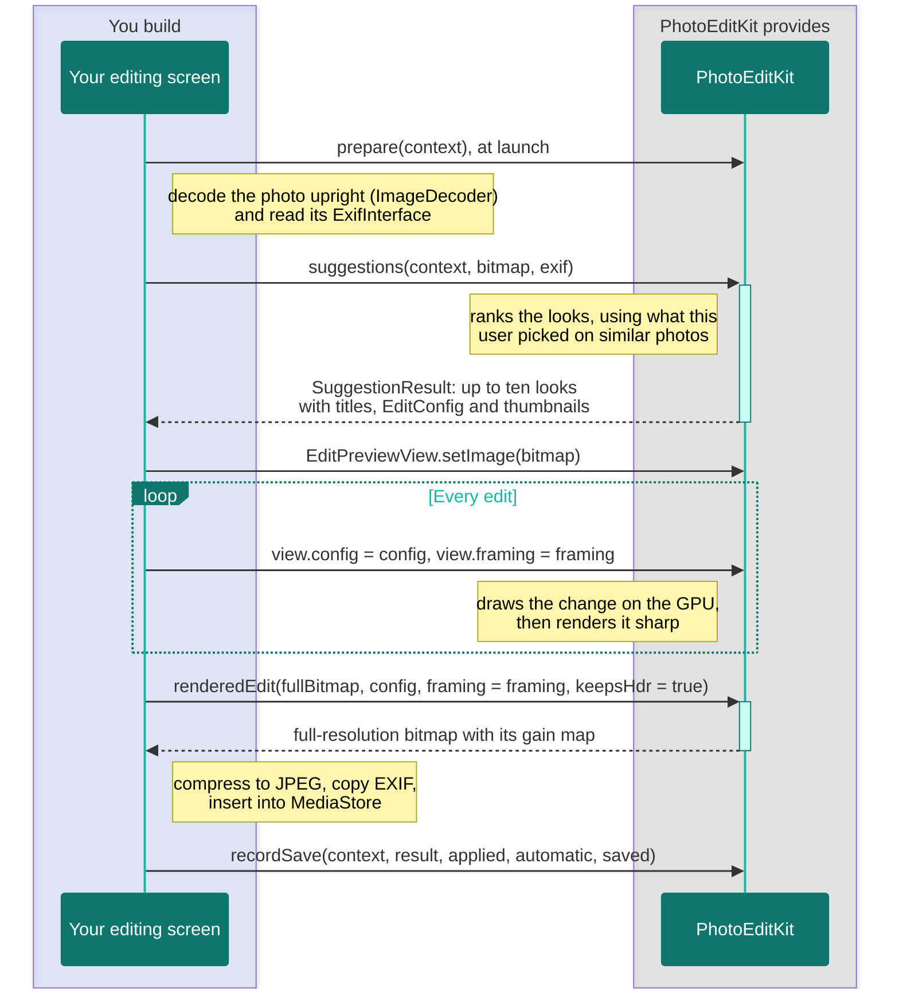

| Your app provides | PhotoEditKit delivers |
|---|---|
| The photo as an upright `Bitmap`, and its `ExifInterface` | AI scene/tone analysis and ranked [suggestions](#ai-suggestions) with localized titles and thumbnails |
| The editing UI: look picker, sliders, crop controls, undo/redo | [`EditConfig`](#edits-editconfig) values for every slider, [`Framing`](#framing-straighten-crop-turn) geometry, a [preview view](#showing-an-edit-editpreviewview) and [renders](#rendering-an-edit) for export |
| Saving: JPEG encoding, EXIF, MediaStore, sharing | [Ultra HDR gain maps](#saving-with-ultra-hdr), [Motion Photo](#motion-photos) writing, [video export](#editing-videos) and [preference learning](#learning-from-saves) |

## Examples

Each photo on the left, and on the right the edit the AI suggested for it.

| Original | AI edit |
| :---: | :---: |
| 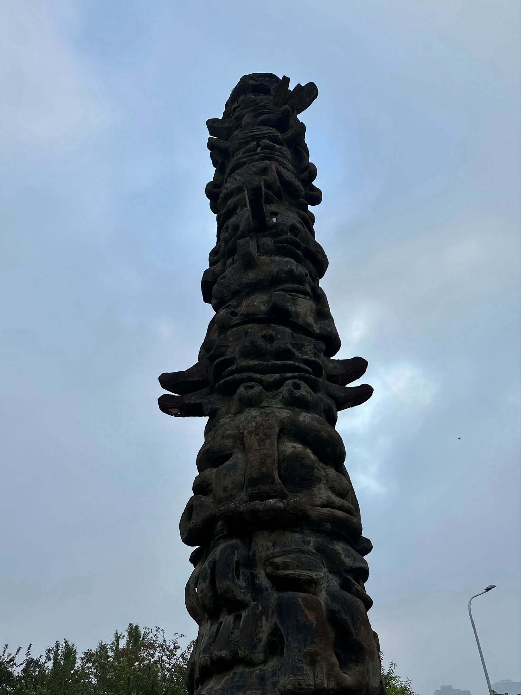 |  |
| 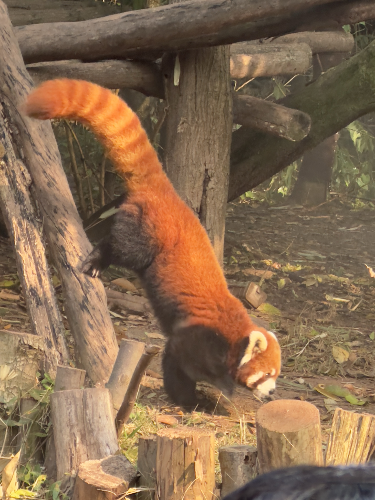 |  |
| 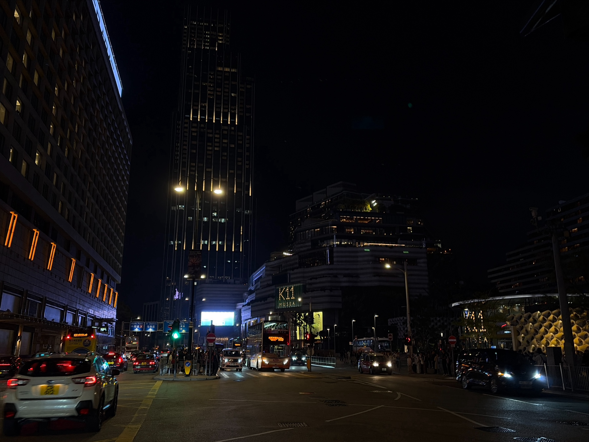 | 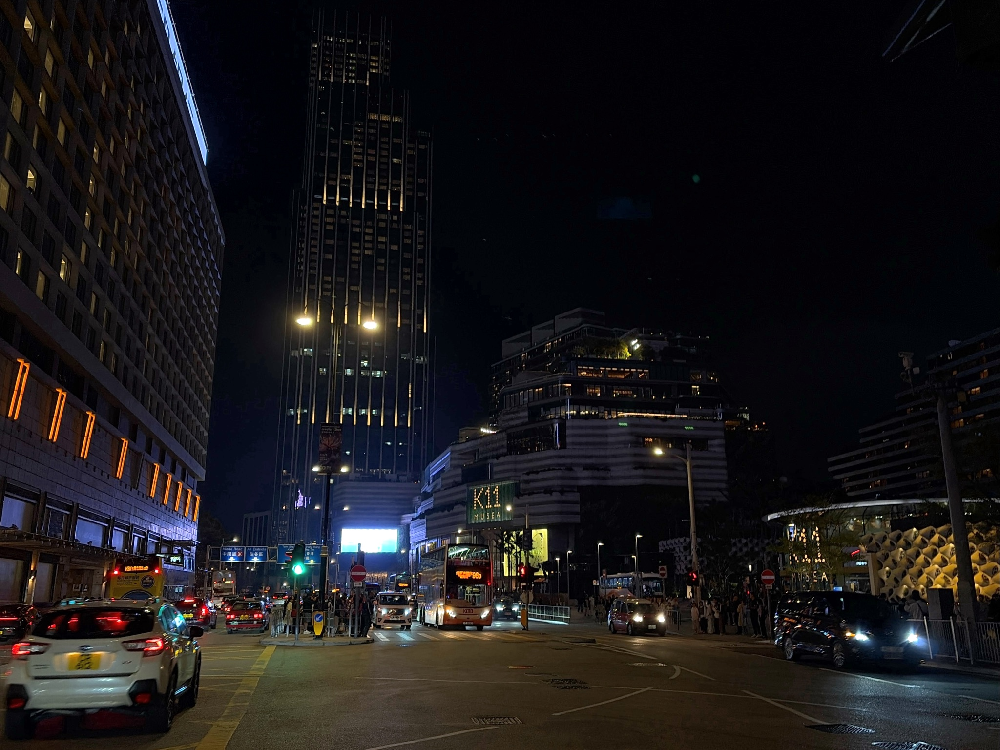 |
| 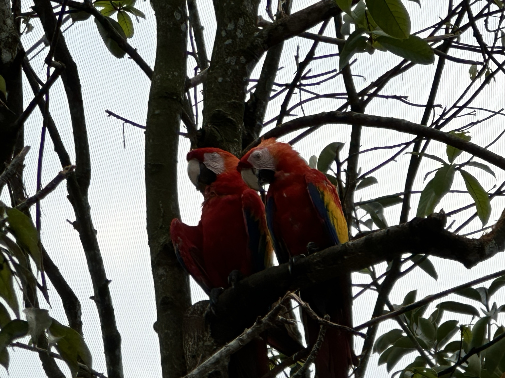 | 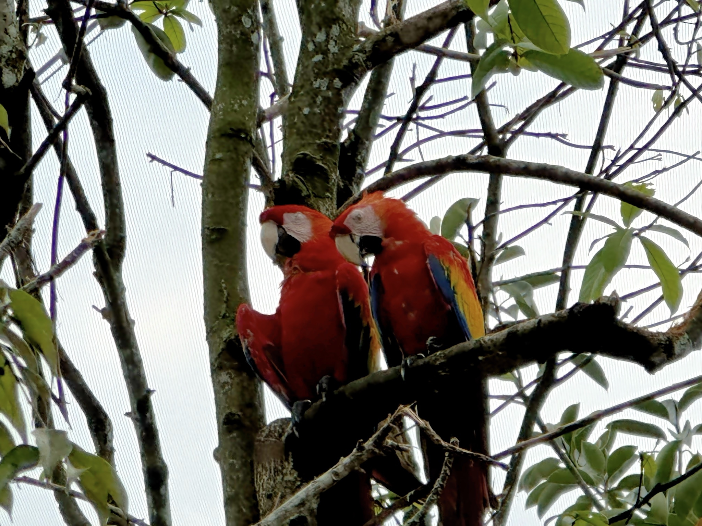 |
| 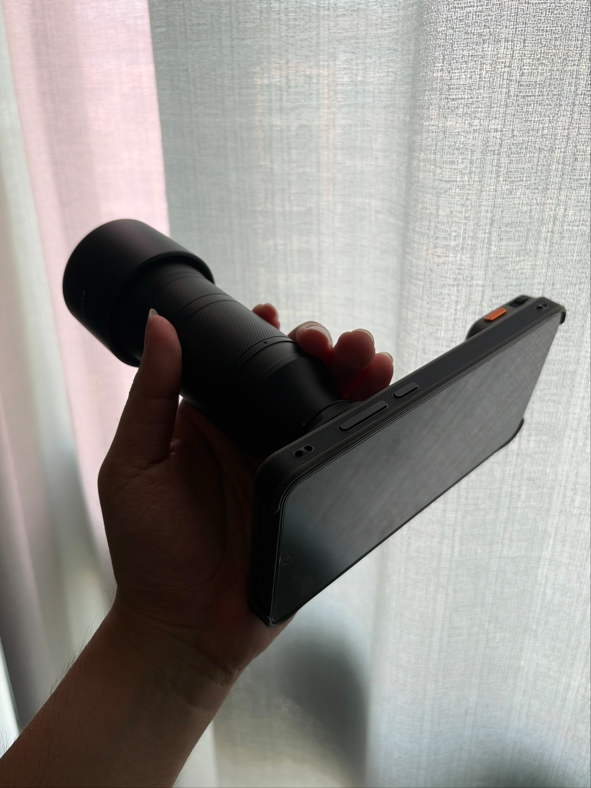 | 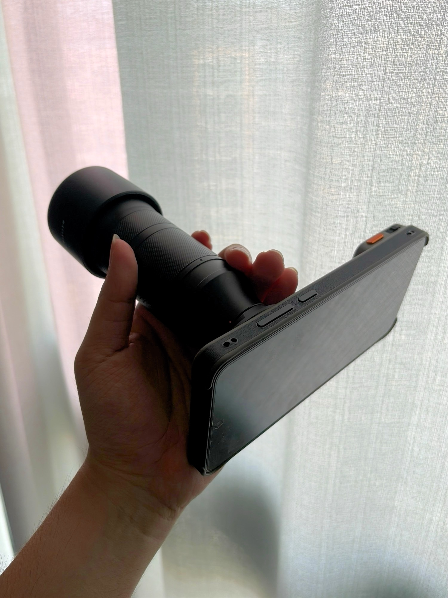 |
| 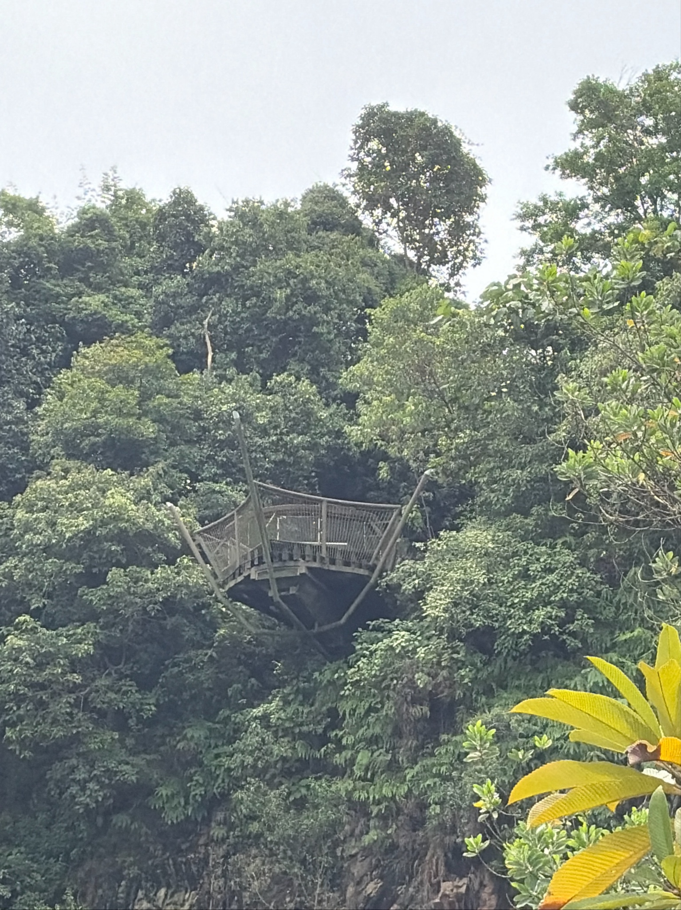 |  |

## Requirements

- **Android 10 (API 29)** or later.
- **64-bit ARM (`arm64-v8a`) only.** The AI engine is a native library built
  for arm64 alone, which covers current Android phones and arm64 emulator
  images (the default on Apple silicon Macs). x86 and x86_64 emulators, and
  32-bit-only devices, are not supported. Restrict your app to arm64 so Google
  Play doesn't offer it to devices that can't run it:

  ```kotlin
  android {
      defaultConfig {
          ndk { abiFilters += "arm64-v8a" }
      }
  }
  ```
- **compileSdk 36** or later, and Kotlin 2.2 or later (AGP 9's built-in
  Kotlin is fine).
- **Media3 1.11.x.** The video features build on Media3 1.11.1, which the
  library brings in. Keep your app's own Media3 dependencies on 1.11.x: a newer
  Media3 can break the video preview.

The library adds about 30 MB of native code and models to an arm64 APK (the
AI engine, LiteRT and four small models; Google Play compresses them for
download), plus the Media3 and LiteRT classes, which R8 shrinks in a minified
release build.

## Installation

PhotoEditKit is published as an Android library (AAR) in a Maven repository
hosted in this GitHub repository.

1. Add the repository in `settings.gradle.kts`:

   ```kotlin
   dependencyResolutionManagement {
       repositories {
           google()
           mavenCentral()
           maven("https://raw.githubusercontent.com/8kdesign/PhotoEditKit-Android/main/maven") {
               content { includeGroup("com.logicui") }
           }
       }
   }
   ```

2. Add the dependency to your app module's `build.gradle.kts`:

   ```kotlin
   dependencies {
       implementation("com.logicui:photoeditkit:1.0.3")
   }
   ```

Gradle also brings in what PhotoEditKit uses: LiteRT, Media3, AndroidX
ExifInterface and Kotlin coroutines.

**Without Gradle's Maven support:** each [release](https://github.com/8kdesign/PhotoEditKit-Android/releases)
also has `photoeditkit-<version>.aar` attached. A local AAR doesn't carry its
dependencies, so add them yourself, at the versions listed in
`maven/com/logicui/photoeditkit/<version>/photoeditkit-<version>.pom`.

## Quick start: let the AI edit a photo

```kotlin
import android.graphics.ImageDecoder
import androidx.exifinterface.media.ExifInterface
import com.logicui.photoeditkit.PhotoEditKit

suspend fun autoEdit(context: Context, uri: Uri): Bitmap {
    val resolver = context.contentResolver
    // ImageDecoder applies the EXIF orientation, so the bitmap is upright.
    val photo = ImageDecoder.decodeBitmap(ImageDecoder.createSource(resolver, uri))
    val exif = resolver.openInputStream(uri)?.use { ExifInterface(it) }

    val result = PhotoEditKit.suggestions(context, photo, exif)  // runs in the background
    val best = result.suggestions.firstOrNull() ?: return photo
    return withContext(Dispatchers.Default) { PhotoEditKit.renderedEdit(photo, best.config) }
}
```

Pass the `ExifInterface`. Although optional, it lets the AI tell
intentionally dark scenes (night streets, candlelit interiors) from
underexposed ones using the exposure time, aperture and ISO. Without it,
low-key night scenes are more likely to be brightened. Read it from the
original file: re-exported copies, screenshots and shared images often have
their EXIF stripped.

Pass the photo at full size. Above about 2048 px on the long edge, size has
little effect on the suggestions, but a much smaller copy hides sensor grain,
so noise-related suggestions such as Clean Up can be left out.

## Edits: `EditConfig`

An `EditConfig` describes one edit as slider values. The AI produces them, your
editor keeps a history of them, and the renderer applies them.

```kotlin
val config = EditConfig(mapOf(
    EditSettingType.EXPOSURE to 0.2f,
    EditSettingType.CONTRAST to 0.1f,
    EditSettingType.SATURATION to -0.3f,
    EditSettingType.VIGNETTE to 0.4f,
))
```

Each value is an **offset from neutral**, so `0` (or leaving the key out)
means "unchanged". To scale an edit up or down, multiply its values:

```kotlin
val gentler = EditConfig(config.properties.mapValues { (_, value) -> value * 0.5f })
```

`EditConfig` is an immutable data class. Read a value with
`config.value(EditSettingType.SATURATION)` (0 when untouched). `a + b` adds two
edits' values, clamped to each slider's range, the way an editor stacks
changes. `isNoChange` is true when every value is 0.

### Settings and ranges

| `EditSettingType` | Range | |
|---|---|---|
| `EXPOSURE` | −0.5 … 0.5 | |
| `BRIGHTNESS` | −0.5 … 0.5 | adjusts midtones while anchoring black and white |
| `CONTRAST` | −0.5 … 0.5 | |
| `SHADOW` | −1 … 1 | positive values lift shadow detail |
| `HIGHLIGHT` | −1 … 0 | negative values recover bright detail |
| `SATURATION` | −1 … 1 | |
| `VIBRANCE` | −1 … 1 | boosts muted colours while protecting skin tones, neutral greys, and already-vivid hues |
| `TEMPERATURE` | −1 … 1 | positive is warmer, negative cooler |
| `TINT` | −1 … 1 | positive is more magenta, negative greener |
| `SHADOW_WARMTH` | −1 … 1 | warms or cools shadows and midtones while leaving highlights alone |
| `SHARPNESS` | −1 … 1 | positive sharpens; negative applies painterly smoothing |
| `NOISE_REDUCTION` | 0 … 1 | |
| `VIGNETTE` | −1 … 1 | |
| `BOOST_RED` `BOOST_ORANGE` `BOOST_YELLOW` `BOOST_GREEN` `BOOST_CYAN` `BOOST_BLUE` `BOOST_PURPLE` `BOOST_MAGENTA` | −1 … 1 | colour mixer: saturation of one colour band |
| `HUE_RED` … `HUE_MAGENTA` (same eight bands) | −1 … 1 | colour mixer: shifts hue toward the neighbouring band (positive goes red toward orange, blue toward purple) |
| `LUMINANCE_RED` … `LUMINANCE_MAGENTA` (same eight bands) | −1 … 1 | colour mixer: lightens or darkens a band's colours, leaving greys alone |

Each `EditSettingType` has everything a slider needs: `minValue`, `maxValue`
and a `titleKey` for its localized name:

```kotlin
for (setting in EditSettingType.available) {          // the main sliders, in display order
    val name = PhotoEditKit.title(context, setting.titleKey)  // "Exposure", in the device's language
    Slider(value = config.value(setting), valueRange = setting.minValue..setting.maxValue, /* … */)
}
```

Straightening, crop and turns are not part of `EditConfig`; they are a
separate [`Framing`](#framing-straighten-crop-turn). The `DEPTH`, `ROTATION`,
`FULL_ROTATION`, `CROP` and `ASPECT_RATIO` entries are reserved: the AI never
sets them and the renderer ignores them, so leave them out of your sliders.

Every value is an ordinary slider: suggestions carry no hidden adjustments
that your UI cannot show or change.

## Rendering an edit

```kotlin
val edited: Bitmap = PhotoEditKit.renderedEdit(photo, config)
```

`renderedEdit` blocks while it works, so call it off the main thread. Settings
always render in a fixed order, whatever order they were set in: noise
reduction (and negative sharpness's smoothing) first, then white balance
(temperature, tint), exposure, shadows and highlights, brightness, contrast,
shadow warmth, the colour mixer, vibrance and saturation, then sharpening, and
the vignette last.

Optional parameters:

- **`framing`** straightens, crops, flips and turns the photo first, so the
  vignette is centred on the final frame. See [Framing](#framing-straighten-crop-turn).
- **`renderScale`** for previews smaller than the photo: preview size ÷ full
  size. Sharpening and noise reduction work in pixels, so without it a
  downscaled preview looks sharper and grainier than the saved photo.
- **`into`** a mutable `ARGB_8888` bitmap of the output size to write into
  instead of allocating a new one. Never pass a bitmap that is still on screen.
- **`keepsHdr`** keeps the photo's HDR gain map. See [Saving with Ultra HDR](#saving-with-ultra-hdr).

Rendering runs on the CPU. As a guide, measured on an arm64 emulator on an
Apple M2 Mac: a 12 MP tone edit takes about 0.4 s, and noise reduction adds
1–2 s at full size. Render previews at screen size.

Wide-gamut (Display P3) bitmaps are converted to sRGB before rendering, so the
output is sRGB.

## Showing an edit: `EditPreviewView`

`EditPreviewView` is an Android `View` that shows a photo with an edit and
keeps up with a slider. Set the photo once, then set the edit whenever it
changes:

```kotlin
val preview = EditPreviewView(context).apply { cornerRadius = 24f }

preview.setImage(uri)            // or setImage(bitmap)
preview.config = suggestion.config
preview.framing = framing        // optional
preview.showsOriginal = true     // while the user holds to compare
```

While a slider is held, set `isAdjusting`, and clear it when the finger lifts:

```kotlin
fun onExposureMoved(value: Float) {
    preview.isAdjusting = true
    preview.config = EditConfig(config.properties + (EditSettingType.EXPOSURE to value))
}

fun onExposureReleased() {
    preview.isAdjusting = false
}
```

What it does to stay fast:

- **Loads only what it shows.** `setImage(uri)` decodes the photo straight to
  screen size (at most `maxPreviewSize`, 2048 px by default, on the long
  side). `setImage(bitmap)` scales a full-size bitmap down once. Pass the
  bitmap at the size you'll save, so sharpening and noise reduction look the
  same on screen as in the saved photo.
- **Shows something at once.** The unedited photo appears first, then a quick
  half-size render, then the sharp one.
- **Draws slider moves on the GPU** on Android 13 and later: the colour change
  is drawn over the last sharp render in a few milliseconds, with no render.
  Noise reduction, sharpening and vignette changes, and every change on
  Android 10–12, show as half-size renders until the finger lifts.
- **Renders one edit at a time, always the newest**, in the background, and
  reuses the output bitmaps.

The photo is drawn whole and centred, with rounded corners from
`cornerRadius`. With `wrap_content` the view takes the photo's shape.
`onLoadFailed` reports a Uri that can't be decoded. Call it from the main
thread.

The view keeps no saved state. After a configuration change, set the photo
and edit on the new view again. In Jetpack Compose, wrap it in `AndroidView`:

```kotlin
AndroidView(
    factory = { EditPreviewView(it) },
    update = { view ->
        view.setImage(photo)           // the same bitmap again does nothing
        view.config = config
        view.framing = framing
        view.isAdjusting = isDragging
        view.showsOriginal = isComparing
    },
    modifier = Modifier.fillMaxSize(),
)
```

For export, render the full-size photo with `renderedEdit`. The view's
bitmaps are screen-sized.

## AI suggestions

```kotlin
val result: SuggestionResult = PhotoEditKit.suggestions(context, photo, exif)
for (suggestion in result.suggestions) {
    suggestion.title      // "Brighten", in the device's language
    suggestion.config     // EditConfig to apply
    suggestion.thumbnail  // 240 px rendered preview, ready for a picker
    suggestion.look       // AILook.BRIGHTEN; null for Original
}
```

`suggestions` is a `suspend` function and runs on `Dispatchers.Default`.
It returns up to ten looks ranked by relevance, or none for a photo that is
already well-balanced. Optional parameters:

- **`maxSuggestions`** limits the number of looks (default `10`). A lower
  limit keeps the best of the same list in the same order.
- **`offerOriginal = true`** puts an **Original** suggestion (no edit,
  `look == null`) first whenever no look improves on the photo as it is.
- **`includeThemes = true`** appends stylized [themes](#themes) that suit the
  photo (Manga, B&W, Film, Matte) after the regular looks, outside the count limit,
  with `isTheme` set. Themes never change which other looks are offered or
  their order.
- **`disabledLooks`** a set of `AILook` values (such as
  `setOf(AILook.TRUE_COLOR)`) never to offer; the next best looks take their
  place.

The photo must be upright: decode it with `ImageDecoder`, which applies the
EXIF orientation, or rotate it yourself. A pass takes about 0.4 s on an arm64
emulator on an M2 Mac, plus the thumbnails.

### Faster first photo

The first call loads the native engine and the models. Call `prepare` when your
app starts, off the main thread, so the first photo doesn't wait for it:

```kotlin
class MyApp : Application() {
    override fun onCreate() {
        super.onCreate()
        CoroutineScope(Dispatchers.Default).launch { PhotoEditKit.prepare(this@MyApp) }
    }
}
```

Calling it again does nothing.

### Scene

```kotlin
result.scene                // AIScene.NATURE, or null
result.sceneGuesses         // the top scene and the runner-up, with confidence 0…1
PhotoEditKit.classifyScene(context, photo)   // the scene alone, without suggestions

PhotoEditKit.title(context, AIScene.NATURE.titleKey)   // "Nature", localized
```

The scenes are `PEOPLE`, `ANIMALS`, `FOOD`, `OBJECT`, `INDOOR`, `CITY`, `SKY`,
`NATURE` and `LIGHT`.

### Learning from saves

Suggestions adapt to the person using your app. When a photo is saved, tell
PhotoEditKit what happened:

```kotlin
PhotoEditKit.recordSave(
    context,
    result,                       // the SuggestionResult the looks came from
    applied = currentSuggestion,  // the look on the photo when saved, or null
    automatic = false,            // true if your app applied it, rather than the user picking it
    saved = currentConfig,        // the saved edit, including the user's slider changes
)
```

PhotoEditKit records which looks were offered, which one was on the photo, and
how far each slider was moved from it. Later suggestions use those records in
two ways:

- **Order.** Looks the user picks move up the list. Looks shown above the one
  they picked, and the top looks when they save with none, move down.
- **Values.** If the user keeps adjusting a look the same way, for example
  lowering Vivid's saturation, that look starts closer to where they leave it.

Learning depends on the kind of photo. Each record is matched by how similar
its photo is to the new one, using a summary of the analysis: brightness,
contrast, colour, grain, faces and scene. Only close matches count, and
nothing changes until there are a few of them. A habit on food photos doesn't
change landscapes, and a change made after one look applies only to that
look.

**Bounds and guardrails:**
- **Ranking changes:** a preferred look can move only a few places up the list.
- **Adjustment limits:** values adapt by at most 15% of each slider's range.
- **Preserved guardrails:** the rules for skin tones, grain, clipping and
  minimum visible change still apply.
- **Fixed creative intent:** a recipe never turns into its opposite (*Cool
  Down* can relax toward neutral, but never warms).

Without `recordSave`, the recipes are used unchanged.

```kotlin
PhotoEditKit.learnedEditCount(context)    // how many saves are recorded
PhotoEditKit.resetLearnedEdits(context)   // forget them all
```

Consider offering the reset in your settings screen.

## The recipes

Each suggestion comes from a fixed set of recipes. The AI selects only the
recipes appropriate for the image, calibrates each value to the photo, and
ranks the most impactful edit first. The same recipe adapts to the scene:
Vivid on a landscape leans into foliage greens, while Vivid on a night street
intensifies neon lights.

There are two kinds. **Corrections** fix something about the photo: its
exposure, its colour or its noise. **Styles** are a matter of taste. When a
photo needs fixing, corrections come first.

### Corrections

| Recipe | What it does |
|---|---|
| Clean Up | Reduces grain and noise, and leaves tone and colour alone. |
| Brighten | Lifts a photo that came out too dark. The subject's own colours are lifted a little further than the rest, through the colour mixer's luminance. |
| Deepen | The opposite of Brighten: richer blacks and more contrast for a photo that looks grey or washed out, without lightening it. |
| Recover Highlights | Brings back detail in bright areas such as a sky. Ranks lower when what's blown out is away from the subject, such as a white border or a lit window, since a JPEG has no detail left there to bring back. |
| Lift Shadows | Opens up dark areas without brightening the rest of the photo, including a subject that's dark against a bright sky or window, such as a hand held up against a sunlit curtain. |
| Warm Up | Takes a blue or cold colour cast back to neutral. |
| Cool Down | Takes an orange or yellow colour cast back to neutral. |
| True Color | Corrects mixed-lighting casts while keeping the scene's real colours:<br><br>• **Open-shade cast:** warms cool, milky shadows and restores lost contrast in daylight scenes.<br>• **White neutralization:** removes subtle green or magenta casts from white surfaces without mistaking naturally pale subjects (such as lavender ice cream in focus).<br>• **Ambient light kept:** leaves intentional light alone, such as warm interior lamps and night lighting.<br>• **Protective compensations:** sky blues stay blue, foliage keeps its colour, and shifted skin tones are brought back to natural. |

Warm Up and Cool Down correct a cast; they don't add one. A photo with
balanced colour gets neither.

### Styles

| Recipe | What it does |
|---|---|
| Crisp | Sharper detail with a little more contrast. |
| Punch | Stronger contrast with a moderate colour boost. Keeps the photo's warmth: it doesn't warm or cool it. Deepens a daylight blue sky. |
| Pop | Brighter and punchier at once, for a light-coloured subject in a dim room, such as a glass of juice under a lamp. The subject's own colours are lifted further than the rest of the photo. Not offered on photos with a lot of white. |
| Vivid | Richer, more saturated colour, led by the colours the photo is about. Uses vibrance for much of it, so muted colours gain the most while skin and colours that are already strong are left nearly as they were; on photos of people it uses vibrance alone. Deepens a daylight blue sky rather than oversaturating it, and turns the yellowish greens of sunlit leaves toward true green. |
| Muted | Quieter colour overall, while the main subject keeps its own. Takes out more colour the more colourful the photo is. |
| Soft | A gentle finish: low contrast and open shadows. Leaves colour alone. |
| Spotlight | Darkens the edges to draw the eye to the middle of the photo. Leaves colour alone. |

### Themes

Themes restyle a photo as something else rather than improve it. They are only
offered with `includeThemes = true`, always after the corrections and styles.

| Theme | What it does |
|---|---|
| Manga | A hand-painted anime look: bright, open shadows, soft highlights, light cyan anime skies and clean leaf greens, and fine detail flattened into painted patches (negative `SHARPNESS`). City, nature and sky photos in daylight only, not sunsets or night. |
| B&W | Black and white, with contrast, highlights and shadows set for the photo; a warm sunset sky is darkened as a blue filter does on film, through the colour mixer's luminance. Only offered on photos with strong contrast, or a city lit up at night. |
| Film | A print from colour negative film: muted colour (greens turned toward olive, blues toward teal), strong contrast that follows the photo's own light, highlights rolled off, a little warmth and green tint, and a very subtle vignette. Eases off on faces and on a subject that is already dark. Not offered on night or dark photos. |
| Matte | A faded print: softened blacks, gentler colour and a light vignette. Fades more on a contrasty photo, less on a flat one, and lifts deep blacks less. Not offered at night or in a dim room, on a photo with a strong warm cast, or on food. |

### Every recipe

- **Faces:** every recipe, corrections included, is adjusted so skin keeps a
  natural hue and saturation, and faces are brightened slightly without
  brightening the rest of the photo. A clearly blurred face near the middle of
  the frame is sharpened slightly (except in Clean Up and Soft). Faces smaller
  than about 2% of the frame count for less.
- **Subject and focus:** the AI works out where the subject is from faces,
  where the eye is drawn and what's in focus. It also finds hands, so a hand
  held up dark against a bright background is lifted even when it is too thin
  to stand out on its own. On a photo with a shallow depth of field, Brighten,
  Lift Shadows and Recover Highlights judge mostly by the part in focus.
- **Grain:** on a night or clearly overexposed photo, a recipe that would make
  grain more visible, such as a shadow lift, adds noise reduction for it. A
  lift that the grain would make too costly is cut back, or the recipe is
  dropped.
- **Small edits are skipped:** a recipe that would barely change the photo isn't
  offered, so a good photo can get only a few suggestions.
- **Similar looks are spread out:** when two suggestions would look nearly
  the same, the second moves down the list.

## Framing: straighten, crop, turn

`Framing` holds the geometry of an edit. It is applied in this order:
straighten, crop, flip, then quarter turns.

```kotlin
var framing = Framing()
framing = framing.copy(straighten = 3.5f)                       // degrees, −45…45, clockwise
framing = framing.croppedTo(AspectRatio.R4_3, photo.width.toFloat() / photo.height)
framing = framing.rotatedClockwise()                            // a quarter turn
framing = framing.mirrored()                                    // flip, as the photo now stands

val edited = PhotoEditKit.renderedEdit(photo, config, framing = framing)
val framedOnly = PhotoEditKit.framedImage(photo, framing)      // no colour edit
```

- `crop` is a `CropRect` of fractions of the straightened photo, measured from
  its top-left corner, before turns. `null` (or `CropRect.FULL`) is the whole
  photo. No side may be smaller than `CropRect.MIN_SIDE`.
- The photo is enlarged as it is straightened so the frame stays filled;
  `Framing.straightenScale(degrees, width, height)` gives the factor, for
  drawing your own crop overlay.
- `AspectRatio` lists the crop shapes (Original, Free, 21:9 … 9:21), each with
  a `titleKey`; `turned` gives the same ratio the other way round.

## Building your own preview

`EditPreviewView` is built from public functions, so you can draw the edit
some other way, for example in your own OpenGL or Compose canvas:

- **Render small.** Render a screen-sized copy of the photo with
  `renderScale` set to its size over the photo's.
- **Reuse a bitmap.** `renderedEdit(…, into = bitmap)` writes over a bitmap you
  are no longer showing, so a drag doesn't allocate a new bitmap per frame.
  Keep two and swap them.
- **Draw on the GPU.** `PhotoEditKit.colorTable(config)` returns the edit's
  colour as a 33 × 33 × 33 lookup table in a 33 × 1089 bitmap (x = blue,
  y = red × 33 + green; interpolate between grid points). It holds every step
  but noise reduction, sharpening and the vignette, and takes a few
  milliseconds. To keep the last render's noise reduction, sharpening and
  vignette while a slider moves, draw
  `last full render + table(new)(source) − table(old)(source)`.

## Saving with Ultra HDR

On Android 14 and later, an HDR photo decoded with `ImageDecoder` carries its
gain map (`Bitmap.gainmap`). Pass `keepsHdr = true` when rendering for a save,
and the gain map is framed with the photo and put on the result, so
`Bitmap.compress` writes an Ultra HDR JPEG:

```kotlin
val output = withContext(Dispatchers.Default) {
    if (config.isNoChange) PhotoEditKit.framedImage(photo, framing, keepsHdr = true)
    else PhotoEditKit.renderedEdit(photo, config, framing = framing, keepsHdr = true)
}
file.outputStream().use { output.compress(Bitmap.CompressFormat.JPEG, 95, it) }
```

Leave `keepsHdr` off for previews, which are shown in SDR. On older Android
versions, or for a photo without a gain map, it does nothing.

`Bitmap.compress` writes no EXIF. Copy the tags you want to keep from the
original with `ExifInterface` after writing the file, and set the orientation
to normal, since the saved pixels are already upright.

## Motion Photos

`MotionPhoto` reads and writes Google Motion Photos (a JPEG with its short
video appended, as Pixel and Samsung cameras save them):

```kotlin
val bytes = resolver.openInputStream(uri)?.use { it.readBytes() } ?: return
val parts = MotionPhoto.read(bytes)              // null: not a Motion Photo
if (parts != null) {
    val video = File(cacheDir, "motion.mp4")
    video.writeBytes(bytes.copyOfRange(parts.videoOffset.toInt(), bytes.size))

    // Save: the edited still, the video with the same edit, then pair them.
    val editedVideo = File(cacheDir, "motion-edited.mp4")
    exportVideo(context, Uri.fromFile(video), VideoLook(config), framing, editedVideo)
    MotionPhoto.write(editedStillJpegBytes, editedVideo, parts.presentationTimeUs, outputFile)
}
```

To check a large file without reading all of it, pass the first
`MotionPhoto.HEAD_SIZE` bytes and the file length to `MotionPhoto.read(head,
fileLength)`, then check the video's first bytes with `isMovieStart`. When the
still is an Ultra HDR JPEG, `write` keeps its gain map. HEIC Motion Photos are
not read.

## Editing videos

The video API builds on Media3 and is marked `@UnstableApi`, so opt in where
you use it: `@OptIn(UnstableApi::class)`.

### 1. Suggest a look

Get suggestions for the video's first frame, leaving out what video can't use
(sharpening and noise reduction would shimmer from frame to frame):

```kotlin
val frame = MediaMetadataRetriever().use {
    it.setDataSource(context, uri)
    it.getFrameAtTime(0)
} ?: return                                      // null: no frame to read
val result = PhotoEditKit.suggestions(
    context, frame,
    movieFrame = true,
    disabledLooks = VIDEO_DISABLED_LOOKS,
    excludedSettings = VIDEO_EXCLUDED_SETTINGS,
)
```

### 2. Work the look out through the video

`VideoEdit` finds where the scene changes (keyframes) and works the chosen look
out again on each, so it follows the light through the video:

```kotlin
val edit = VideoEdit(context, uri)
edit.start { currentSuggestion }   // finds keyframes, then works out the current look
edit.match(suggestion)             // call whenever the applied look changes
// …
edit.close()                       // when done
```

`keyframeTimes` (seconds; null until found), `revision` (bumped whenever a
look's keyframes land or an adjustment changes) and `building` are
`StateFlow`s to observe. `isWorkingOut(suggestion)` says whether a look is
still being worked out.

### 3. Preview it

```kotlin
val state = VideoEditState(edit.look(suggestion, config))
val player = editingPlayer(context).apply {
    setVideoEffects(videoEffects(state, framing))
    setMediaItem(MediaItem.fromUri(uri))
    prepare()
}

// When the edit changes, or keyframes land (revision):
state.look = edit.look(suggestion, config)
if (!player.isPlaying) state.heldTimeUs = player.currentPosition * 1000
player.redrawEdit()          // shows the change on a paused frame

// Hold to compare:
state.showsOriginal = true
```

Set `heldTimeUs` while paused or seeking, and back to `null` when playback
starts. When the framing changes, call `setVideoEffects` again. `editingPlayer`
is an ExoPlayer; use it with your own `PlayerView` or `SurfaceView`.

### 4. Adjust at a keyframe

`edit.keyframeTimes` lists the keyframes. The first is always 0, and its edit
is your editor's own `config`. At any later keyframe, store the user's changes
in `VideoEdit`:

```kotlin
// What the user sees at the keyframe at `time`: the look as worked out for
// that scene, with their own changes.
val shown = edit.look(suggestion, config).config(time).value(EditSettingType.EXPOSURE)

// The user moved exposure to `newValue` (keep it within the setting's range).
val changes = edit.adjustments(time, suggestion)
val exposure = (changes[EditSettingType.EXPOSURE] ?: 0f) + newValue - shown
edit.setAdjustments(changes + (EditSettingType.EXPOSURE to exposure), time, suggestion)
```

- A change is an amount added on top of the look at that keyframe. It fades
  in from the keyframe before and out to the one after, so it doesn't jump in
  on a cut.
- Changes are kept separately for each look. Picking another look shows that
  look's own changes, and picking the first again brings its changes back.
- `setAdjustments` replaces all the keyframe's changes. Settings set to 0 are
  dropped. A time that isn't one of `keyframeTimes`, or is the first, is
  ignored.
- `allAdjustments(suggestion)` returns every keyframe's changes. Undo and redo
  for them are up to your app.
- Each change bumps `revision`; `look` and `finishedLook` include the changes,
  so the preview and the export have them.

Until a look is worked out for every keyframe (`isWorkingOut(suggestion)`),
each keyframe shows the first frame's values, so hold the controls at later
keyframes still until then.

### 5. Export

```kotlin
val look = edit.finishedLook(suggestion, config)   // waits until the look is worked out
exportVideo(context, uri, look, framing, outputFile) { progress -> /* 0…1, main thread */ }
```

The export is an MP4: HEVC where the phone can encode it at the video's size,
otherwise H.264. The audio is passed through. HDR videos are tone-mapped to
SDR, in the preview and the export.

## Threading

- `suggestions`, `recordSave`, `classifyScene` and `finishedLook` are `suspend`
  functions that move their work to a background dispatcher. Call them from
  any coroutine.
- `renderedEdit`, `framedImage`, `colorTable`, `prepare` and `VideoLook.config`
  block while they work. Call them off the main thread (for example in
  `withContext(Dispatchers.Default)`).
- `EditPreviewView` is set from the main thread and renders in the
  background.
- `VideoEdit` changes its state on the main thread and does its work in the
  background. `exportVideo` reports progress on the main thread.

## Localization

Look, scene and setting names are Android string resources, read through
`PhotoEditKit.title(context, key)` or already resolved in
`EditSuggestion.title`.

| Language | Resource qualifier |
|---|---|
| English | default |
| Simplified Chinese | `zh-rCN` |
| Traditional Chinese | `zh-rTW` |
| Japanese | `ja` |
| Korean | `ko` |

Android shows the library's strings in the device's language even when your
app isn't translated into it. To keep them in step with your app, list your
languages in `androidResources { localeFilters += listOf("en", …) }`.

## Privacy

PhotoEditKit makes no network requests and collects nothing. Photos, metadata
and suggestions stay on the device. It doesn't download any models, so it
works offline from the first launch.

The one thing it writes to disk is the record used for [learning from
saves](#learning-from-saves): `files/PhotoEditKit/LearnedPreferences.json` in
your app's internal storage. It holds no photos or thumbnails, only the photo
summary numbers, look names and slider values for at most the 500 latest saves
(under 0.5 MB). Android Auto Backup includes it unless your backup rules leave
it out. It is deleted with your app, or straight away by `resetLearnedEdits`.

## Troubleshooting

- **`UnsatisfiedLinkError: … libAICore.so`**: the app is running on an x86 or
  x86_64 emulator, or a 32-bit device. Use an arm64 emulator image or phone,
  and see [Requirements](#requirements).
- **`2 files found with path 'lib/arm64-v8a/libc++_shared.so'`**: another
  library also ships the C++ runtime. Add
  `packaging { jniLibs { pickFirsts += "**/libc++_shared.so" } }` to your app.
- **Video preview stops working after upgrading Media3**: keep Media3 on 1.11.x
  (see [Requirements](#requirements)).
- **Dependency requires compileSdk 36**: raise your app's `compileSdk`.

## Support

Found a bug, or a photo the AI edits badly? Please
[open an issue](https://github.com/8kdesign/PhotoEditKit-Android/issues). For a
bad edit, attach the photo (or a copy at around 1024 px) and say which
suggestion looked wrong. Real photos are what the recipes are tuned on.

If PhotoEditKit is useful in your app, a ⭐ helps other developers find it.

## License

PhotoEditKit is free to use, including in commercial apps. It ships as a
binary and is not open source: you may not modify it, reverse engineer it, or
sell or redistribute it on its own. See [LICENSE](LICENSE) for the full terms.
